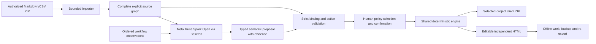

# Architecture and distinctive mechanism

The model interprets fields and visible action effects. It does not re-enumerate
source rows, invent arbitrary relations, emit executable app code, restore hidden
permissions or send external messages. The resolver supplies every explicit unique
relation/observed state. Ambiguity stops before inference; contradiction is rejected.

The original model proposal and source binding resolution are preserved separately
from later policy edits and confirmation. The same command engine controls studio
and portable behavior, including new locally-created records, contextual task
idempotency and guarded project-only exports. The portable HTML includes its data,
runtime and safe local assets; networking is disabled by its content policy.

The public adapter enforces an exact HTTPS origin, bounded input/output and
concurrency, fresh operation consent, idempotency keys and a durable precharged
SQLite quota. Five lifetime reservations have been consumed. Failed calls remain
charged against allowance; domain migration and deployment do not reset history.

Meta use is central to bounded semantic interpretation. Source correctness is a
deterministic responsibility; human policy remains explicit. Neither the number
of services integrated nor a saved result is presented as proof of intelligence.
